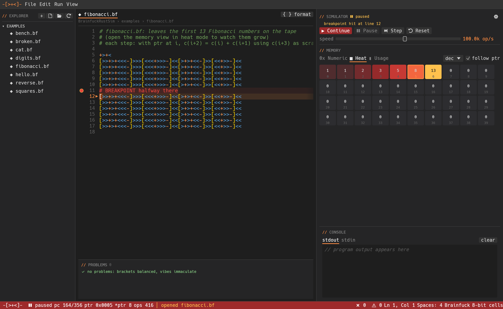

# bfsim  `-[>+<]-`

A fast Brainfuck interpreter, debugger and simulator written in Rust, with a VS Code-style desktop GUI and a CLI.



## Build

```bash
cargo build --release              # builds bfsim (CLI) + bfsim-gui
cargo build --release --no-default-features   # CLI only, no GUI deps
```

## GUI: `bfsim-gui [file.bf]`

- **Explorer** (left): `.bf`/`.b` files in the open folder. Defaults to `./examples`.
- **Editor** (center): syntax highlighting, rainbow bracket pairs, line numbers, error/warning squiggles,
  a problems panel (click to jump), auto-indent after `[`, auto-dedent on `]`, and **Format** (`⇧⌘F`).
- **Simulator** (right): Run/Continue `F5`, Pause `F6`, Step `F10`, Reset `⇧F5`, a speed slider
  from 1 op/s up to TURBO, stdin/stdout console, and machine settings (⚙: cell width, EOF behavior, tape size, pointer wrap).
- **Memory view**: **Numeric** (dec/hex/chr), **Heat** (color ramp 0 → tape max), **Usage** (per-cell access bars + tape usage).

### Breakpoints
Put `# BREAKPOINT` on a line. Execution pauses before the next instruction. You can also click the gutter to toggle
a temporary breakpoint.

`#` starts a line comment by default, so prose like `# done.` won't print. Turn this off in settings or with `--strict`.

## CLI

```text
bfsim run   file.bf [--input STR | --input-file F] [--cell 8|16|32] [--eof zero|unchanged|minus1]
                    [--tape N] [--wrap] [--strict] [--stats] [--dump N]
bfsim debug file.bf          # stops at breakpoints: [c]ontinue, [s]tep, [t]ape, [q]uit
bfsim fmt   file.bf [-w] [--check] [--tabs] [--indent N]
bfsim check file.bf          # syntax errors + lints, exit 1 on errors
```

## Try it

```bash
bfsim run examples/fib_n.bf --input 20      # 6765
bfsim run examples/fib_n.bf --input 1000    # all 209 digits of F_1000, in 0.1s
bfsim run examples/squares.bf
```

## Layout

```
src/core/   parser.rs (lexing, folding, idioms, jump table, breakpoints)
            vm.rs (machine)  formatter.rs  diagnostics.rs
src/gui/    app.rs  editor.rs  memory_view.rs  sim.rs  file_panel.rs  theme.rs
src/bin/    bfsim.rs (CLI)  bfsim-gui.rs
examples/   hello, digits, cat, reverse, fibonacci, fib_n, squares, bench, broken
tests/      end-to-end + CLI tests
tools/      gen_fib_n.py (generates examples/fib_n.bf)
```

`fib_n.bf` does arbitrary-precision math on plain 8-bit cells: each decimal digit gets its own
8-cell group, and the number grows until the tape runs out. The default 30,000-cell tape fits
answers up to about 3,700 digits (n ≈ 17,000); use `--tape` for more. It's generated by
`tools/gen_fib_n.py`, which tracks the pointer so the Brainfuck stays correct. To change it, edit the
script and run `python3 tools/gen_fib_n.py > examples/fib_n.bf`.

The parser folds `+++`/`<<<` runs and turns `[-]`, `[>]` and `[<]` into single ops. The VM runs about 550M ops/s on `bench.bf`.
